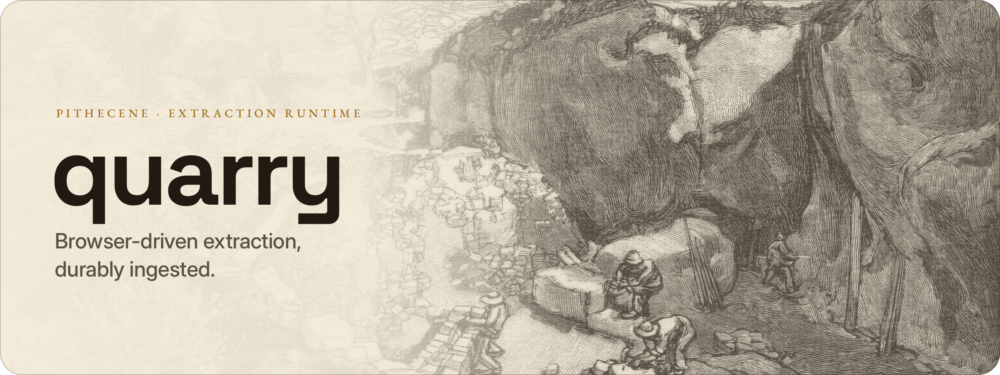

<picture>
  <source media="(prefers-color-scheme: dark)" srcset="docs/assets/quarry-banner-dark.png">
  
</picture>

# Quarry

[](https://github.com/pithecene/quarry/actions/workflows/ci.yml)

**A CLI-first web extraction runtime for browser-driven crawling and durable ingestion**

Quarry is a web extraction runtime for imperative, browser-backed scraping workflows. It is designed for adversarial sites, bespoke extraction logic, and long-lived ETL pipelines where correctness, observability, and durability matter more than convenience abstractions.

Quarry executes user-authored Puppeteer scripts under a strict runtime contract, streams observations incrementally, and hands off persistence to an external substrate (typically [Lode](https://github.com/pithecene/lode)). It is intentionally *not* a crawler framework, workflow engine, or low-code platform.

---

## Installation

### CLI

```bash
mise install github:pithecene/quarry@0.14.0
```

### Docker

```bash
# Full image (includes Chromium + fonts)
docker pull ghcr.io/pithecene/quarry:0.14.0

# Slim image (no browser — BYO Chromium via --browser-ws-endpoint)
docker pull ghcr.io/pithecene/quarry:0.14.0-slim
```

See the [container guide](docs/guides/container.md) for Docker Compose examples.

### SDK

```bash
npx jsr add @pithecene/quarry-sdk
```

See the [SDK and setup guide](PUBLIC_API.md) for setup and usage.

---

## What Quarry Is

- A **runtime**, not a framework
- **CLI-first**, not embedded
- Designed for **imperative Puppeteer scripts**
- Explicit about **ordering, backpressure, and failure**
- Agnostic to storage, retries, scheduling, and downstream processing
- **Not** a crawling DSL or workflow orchestrator
- **Not** a SaaS scraper or low-code pipeline

Quarry's responsibility ends at **observing and emitting what happened**.

---

## Conceptual Model

Quarry enforces a clean boundary between extraction logic and ingestion mechanics:

```
User Script (Puppeteer, imperative)
        ↓
emit.*  (stable event contract)
        ↓
Quarry Runtime
        ↓
Ingestion Policy (strict, buffered, streaming)
        ↓
Persistence Substrate (e.g. Lode)
```

Scripts **emit observations**.  
Policies decide how those observations are handled.  
Persistence decides what survives.

Four components carry out this model:

- **SDK**: the authoring surface for scripts, `emit.*` and the context objects.
- **Executor**: runs a script and streams its events to the runtime.
- **Runtime**: manages runs and applies the ingestion policy.
- **Lode**: stores each run's data under stable partitions.

---

## Pipeline Composition

Quarry is designed to be composed **around**, not extended **from**:

```bash
# Extract
quarry run \
  --script products.ts \
  --run-id "products-$(date +%s)" \
  --source example-store \
  --category products \
  --job '{"url": "https://shop.example.com/products"}' \
  --storage-backend fs \
  --storage-path /var/quarry/data \
  --policy buffered

# Transform (outside Quarry)
catalog-transform \
  --input /var/quarry/data/source=example-store \
  --output /var/quarry/normalized

# Index / analyze (outside Quarry)
catalog-index \
  --input /var/quarry/normalized
```

Quarry owns **only** the extraction step.

---

## Quick Example

Quarry scripts are **freestanding programs**, not libraries.

They should:
- Accept all inputs via the job payload
- Use real Puppeteer objects (`page`, `browser`)
- Emit all outputs via `emit.*`
- Avoid shared global state
- Remain agnostic to durability and retries

### Example

```ts
import type { QuarryContext } from '@pithecene/quarry-sdk'

export default async function run(ctx: QuarryContext): Promise<void> {
  await ctx.page.goto(ctx.job.url)

  const products = await ctx.page.evaluate(() => {
    // scrape DOM
    return []
  })

  for (const product of products) {
    await ctx.emit.item({
      item_type: 'product',
      data: product
    })
  }

  await ctx.emit.runComplete()
}
```

Scripts are imperative, explicit, and boring by design.

---

## Key Concepts

- **Emit API**: all script output flows through `emit.*` → [emit guide](docs/guides/emit.md)
- **Policies**: strict, buffered, or streaming ingestion control → [policy guide](docs/guides/policy.md)
- **Storage**: FS and S3 backends via Lode → [storage guide](docs/guides/lode.md)
- **Proxies**: pool-based rotation with multiple strategies → [proxy guide](docs/guides/proxy.md)
- **Streaming**: chunked artifacts with backpressure → [emit guide](docs/guides/emit.md#streaming-and-backpressure)
- **Configuration**: YAML project defaults via `--config` → [configuration reference](docs/guides/configuration.md)
- **Browser Reuse**: transparent Chromium persistence across sequential runs → [configuration reference](docs/guides/configuration.md)
- **Container Deployment**: full/slim images, shared browser pools, multi-crawler topologies → [container guide](docs/guides/container.md)
- **Integration**: webhook and Redis adapters for downstream triggers → [integration guide](docs/guides/integration.md)
- **Fan-Out**: derived work execution via `emit.enqueue()` → [emit guide](docs/guides/emit.md)
- **Run Lifecycle**: terminal states and exit codes → [run guide](docs/guides/run.md)

---

## Documentation

| Resource | Path |
|----------|------|
| Guides | [docs/guides/](docs/guides/) |
| Contracts | [docs/contracts/](docs/contracts/) |
| Public API | [PUBLIC_API.md](PUBLIC_API.md) |
| SDK | [sdk/README.md](sdk/README.md) |
| Examples | [examples/](examples/) |
| Support | [SUPPORT.md](SUPPORT.md) |
| Changelog | [CHANGELOG.md](CHANGELOG.md) |

---

## Status

Quarry is under active development.

- Contracts frozen, SDK stable
- FS and S3 storage supported
- Platforms: linux/darwin, x64/arm64, container (GHCR)

Breaking changes are gated by contract versioning.

---

## License

Apache License 2.0 (see [LICENSE](LICENSE)). Copyright © 2026 Pithecene LLC. Contact: contact@pithecene.sh.
